# PathSnap: map-matching noisy GPS to a road network

PathSnap takes a noisy GPS trace and works out which road segments the vehicle actually drove on. It does this in two stages: a machine-learning classifier scores nearby road segments for every GPS point, and an HMM with Viterbi decoding turns those scores into one connected route.

This README is written so that anyone on the team can read it from top to bottom and then present the exploratory data analysis (EDA) and the five models without opening any code.

## Contents

1. [What we are trying to do](#1-what-we-are-trying-to-do)
2. [Repository map](#2-repository-map)
3. [Data and EDA](#3-data-and-eda)
4. [Candidates, labels and features](#4-candidates-labels-and-features)
5. [The five models](#5-the-five-models)
6. [Model comparison and selection](#6-model-comparison-and-selection)
7. [Bayesian hyperparameter optimisation](#7-bayesian-hyperparameter-optimisation)
8. [HMM and Viterbi route reconstruction](#8-hmm-and-viterbi-route-reconstruction)
9. [API, UI and end-to-end results](#9-api-ui-and-end-to-end-results)
10. [Viva cheat-sheet](#10-viva-cheat-sheet)
11. [How to run everything](#11-how-to-run-everything)

---

## 1. What we are trying to do

**The problem.** A phone or car GPS records a position about once a second. The positions are noisy: buildings, tunnels and signal reflections push them sideways, and some seconds are missing. If you plot the raw points they drift onto parallel streets, cut across blocks, and jump. Map-matching is the task of snapping that trace back onto the road network so we know the real route.

**What we are given.**

* A GPS trace for each trip (`.track`): longitude, latitude, timestamp.
* The road network around the trip (`.nodes` = junction coordinates, `.arcs` = directed road segments joining two nodes).
* For the 90 development trips, a reference route (`.route`): the ordered list of road segments the vehicle drove.

**What we produce.** For every GPS point, the road segment (arc id) the vehicle was on, and therefore the full driven route.

**Plain-language example.** A car drives along a two-way street. Its GPS dots sit 5 to 10 m from the road, and some are closer to the parallel street 20 m away. For each dot we list the nearby road segments (the *candidates*), describe each one with numbers (how far, which direction, how well the neighbouring dots also fit), and let a classifier say "this one is probably right". Then, because a car cannot jump between unconnected streets, an HMM picks the sequence of segments that is both well scored and physically connected.

**Why it is hard.**

* The nearest road is often the wrong one. Almost every road is stored as two directed arcs (one per direction) with identical geometry, so distance alone cannot choose between them (see the nearest-arc analysis in section 3).
* Junctions, ramps and parallel roads put several plausible segments within a few metres.
* Gaps in the trace break the usual "next point is near the previous one" assumption.
* The reference route is not perfect (section 3.4).

**Data partitions.**

| Partition | Trips | Use |
|---|---|---|
| `train` | 80 | model fitting, cross-validation, tuning |
| `student_test` | 10 | development-stage comparison of models and decoder |
| evaluator test | 10 | final evaluation only; not available to us and never used for training, tuning or model choice |

Trips are never split across partitions.

---

## 2. Repository map

```
.
├── README.md                  this file
├── requirements.txt           pinned Python dependencies
├── api/main.py                FastAPI backend (runs on Laptop 1)
├── ui/                        static HTML/JS + Leaflet UI (runs on Laptop 2)
├── src/pathsnap/
│   ├── data.py                file loading, per-trip metre projection
│   ├── candidates.py          candidate arcs, reference alignment, the 28 features
│   ├── modeling.py            model definitions, group-CV helpers, metrics
│   ├── hmm.py                 HMM / Viterbi decoder
│   ├── decode_eval.py         classifier-only vs HMM metrics
│   ├── pipeline.py            label-free inference pipeline used by the API
│   ├── scoring.py             server-side scoring against the reference route
│   └── viz.py                 Folium map builder
├── scripts/
│   ├── 00_eda_stats.py        dataset inventory and data-quality table
│   ├── 01_build_dataset.py    candidates + features + labels for train and student_test
│   ├── 02_compare_models.py   five models, 5-fold group CV, student-test evaluation
│   ├── 02b_merge_results.py   merges the per-model outputs
│   ├── 03_bayes_opt.py        Bayesian optimisation of the selected model
│   ├── 04_tune_decoder.py     HMM decoder tuning and classifier-only vs HMM comparison
│   ├── 05_eda_plots.py        EDA figures and Folium EDA maps
│   ├── 05b_extra_eda.py       nearest-arc baseline, speed and gap, candidate-miss figures
│   ├── 06_figures.py          model comparison figures
│   ├── 07_api_check.py        calls the running API for every served trip
│   ├── 08_maps.py             Folium prediction maps
│   ├── run_api.py             starts the API for the two-laptop demo and prints the addresses
│   ├── monitor.py             live pipeline dashboard (http://localhost:8765)
│   └── tui.py                 live progress view in the terminal
├── results/
│   ├── eda/                   inventory CSVs and EDA figures
│   ├── models/                comparison.csv, cv_folds.csv, mlp_history.csv, predictions
│   ├── figures/               model comparison figures
│   ├── maps/                  interactive Folium maps (.html)
│   └── bayes/, hmm/           tuning records and decoder results
├── models/final/              the selected model and decoder configuration
├── docs/                      data_quality.md, how_it_works.md
├── context/                   the event's guideline documents (read these first)
└── handoffs/                  task guides for teammates
```

The raw data folders `train/` and `student_test/` are **not** committed (see section 11).

---

## 3. Data and EDA

All EDA below uses the **training partition** (80 trips) unless a figure says otherwise; the inventory also lists the student-test trips separately. Numbers come from `results/eda/dataset_inventory.csv`, `results/eda/missing_value_summary.csv` and `results/eda/candidate_miss_by_trip_train.csv`.

### 3.1 The four file types

| File | Columns | Meaning |
|---|---|---|
| `.track` | longitude, latitude, timestamp (s) | the GPS observations |
| `.nodes` | longitude, latitude (row index = node id) | road junctions |
| `.arcs` | from_node, to_node (row index = arc id) | directed road segments |
| `.route` | arc id per line | the reference route, in driving order |

A GPS row does not correspond to a row in any road file. The link is spatial: a GPS point is matched to arcs by geometry. Each trip carries its own road sub-network.

### 3.2 Inventory

| | train | student_test |
|---|---|---|
| Trips | 80 | 10 |
| GPS observations (total) | 208,417 | 19,160 |
| GPS observations per trip (min / median / max) | 361 / 1,529 / 19,313 | 262 / 1,420 / 3,958 |
| Road nodes per trip (min / max) | 299 / 155,003 | 1,770 / 26,635 |
| Road arcs per trip (min / max) | 649 / 307,392 | 3,577 / 56,027 |
| Connected components per trip (median / max) | 20 / 421 | 11 / 100 |
| Reference route arcs per trip (min / max) | 59 / 2,266 | 95 / 1,323 |
| Mean step between fixes (average over trips) | 16.6 m | 15.7 m |
| Trips with a gap longer than 5 s | 45 of 80 | 2 of 10 |
| Longest gap | 153,064 s | 210 s |
| Trips containing duplicate arcs | 53 of 80 | 7 of 10 |
| NaN values, non-monotonic timestamps, isolated nodes | 0 / 0 / 0 | 0 / 0 / 0 |

Other facts from the same files:

* In the training partition 96.5 % of fixes arrive exactly 1 s after the previous one, and only 0.6 % arrive more than 5 s after.
* The two partitions together cover 227,577 GPS observations over 90 trips.
* The trips are **not** all from one city. Longitudes range from about -100 to 137 degrees and latitudes from about -35 to 62 degrees, so one fixed map projection would be wrong. We convert each trip to metres with its own local azimuthal-equidistant projection (`src/pathsnap/data.py`).
* On a consecutive-arc check, 98.1 % to 100 % of route arcs connect head to tail in every trip (minimum 98.13 % in training, 99.73 % in student_test), so the reference route is almost always a connected path.

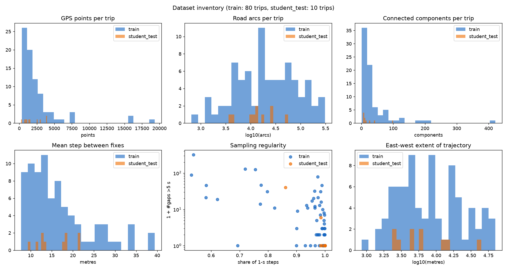

*Figure: dataset inventory (`results/eda/inventory.png`).* Each panel is a histogram (or scatter) over trips; blue is train, orange is student_test. The top row shows trips are mostly short (about 1,500 points) with a few very long ones (up to 19,313), road networks span three orders of magnitude, and most networks are fragmented into many disconnected components. The bottom row shows the mean step between fixes (typically 10 to 20 m per second, so a vehicle moving about 36 to 72 km/h on average), that nearly all trips are close to 1 Hz but some have many gaps (bottom middle, points far to the left or high up), and the very different trip lengths. Takeaway: the trips are heterogeneous, so we must validate by trip, not by random row.

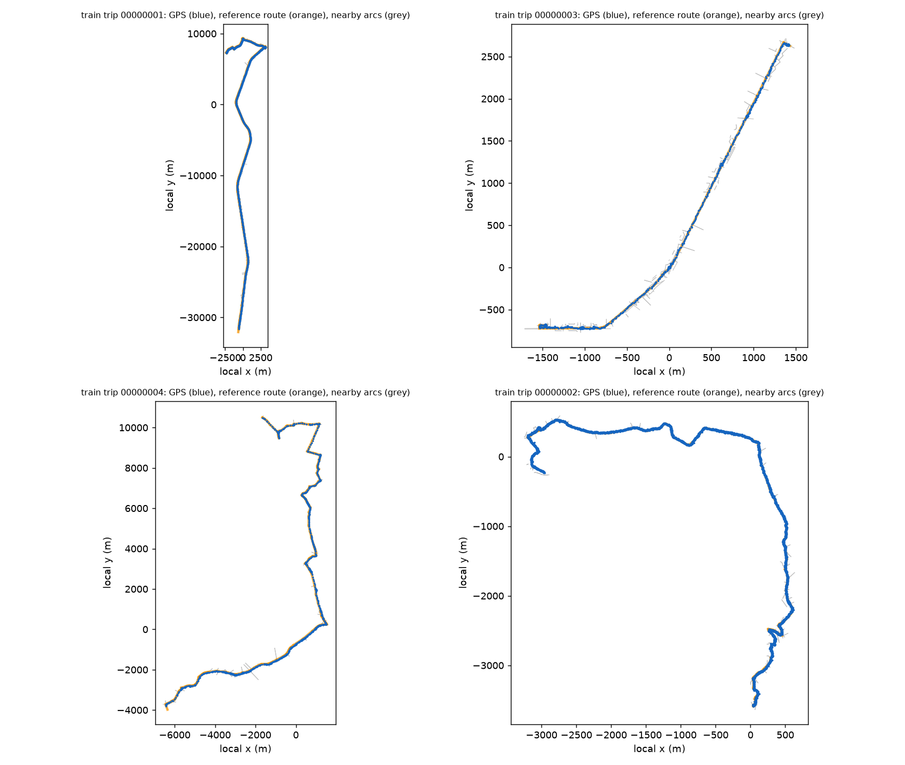

*Figure: four training trips (`results/eda/trajectories_train.png`).* Blue dots are GPS points in local metres, orange is the reference route and grey lines are the arcs near the trace (arcs that are candidates for at least one point). In trips 1, 3 and 4 the dots follow the orange route closely. Trip 2 is a noisy example whose orange route is hard to see under the dots. The grey stubs show side roads and junctions that create ambiguity. Takeaway: most traces hug the road, and the difficulty comes from junctions, parallel roads and direction, not from large noise.

### 3.3 Interactive maps

Two interactive Folium maps of training trips are committed. They are HTML files: GitHub shows the source, so **download the file and open it in a browser**.

* [`results/maps/eda_train_trip_00000001.html`](results/maps/eda_train_trip_00000001.html)
* [`results/maps/eda_train_trip_00000004.html`](results/maps/eda_train_trip_00000004.html)

Each map has toggleable layers: GPS observations, the road network near the trace, and the reference route, plus start and end markers and a legend. Prediction maps for student-test trips (GPS, reference, classifier-only and classifier + HMM) are produced by `scripts/08_maps.py` into `results/maps/pred_student_<trip>.html`.

### 3.4 The reference route is not per-point ground truth, and some trips do not match it

`.route` lists arcs in order. It does not say which arc each GPS point belongs to. We therefore **derive** a per-point label by a monotone dynamic programme that assigns every fix to a route arc (cost = distance to the arc, moving backwards along the route is heavily penalised). Labels are derived, not given.

For most trips the trace sits on the reference route: across the 80 training trips the median fix-to-reference distance is about 4 to 6 m for typical trips (median of the per-trip medians 4.6 m, 95th percentile about 14 m). A handful of trips do not fit:

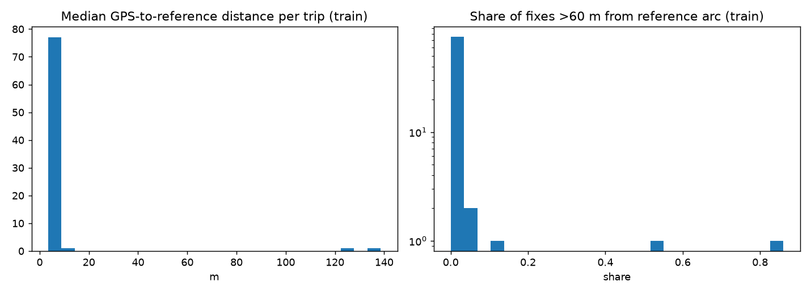

*Figure: distance from fixes to their aligned reference arc (`results/eda/gps_to_reference.png`).* Left: one bar per range of per-trip median distance. 77 of 80 trips sit in the first bar, and two trips (54 and 33, median 138.6 m and 122.4 m) sit far out to the right. Right (log scale): the share of a trip's fixes that lie more than 60 m from the reference arc; almost all trips are near 0, and trips 54 and 33 reach 86 % and 52 %. Takeaway: for two trips the reference route and the GPS trace largely disagree, so their labels are unreliable.

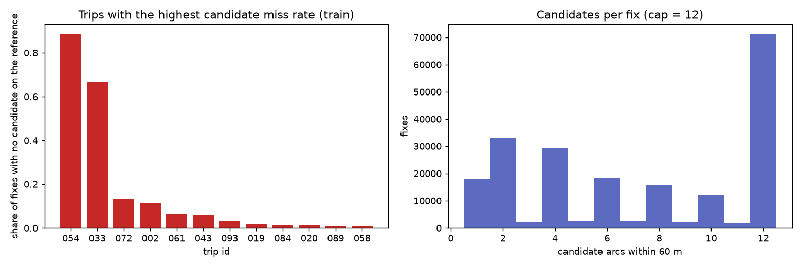

*Figure: candidate miss rate (`results/eda/candidate_miss_by_trip.png`).* Left: the 12 training trips with the most fixes whose reference arc is not among our candidates. Trip 54 misses 88.7 % and trip 33 misses 66.8 %; the next ones are far lower (trip 72: 13.2 %, trip 2: 11.6 %, trip 61: 6.5 %). Right: candidates per fix, capped at 12; 34 % of fixes hit the cap. Takeaway: nearly all missed fixes come from two trips.

Numbers behind this: the overall candidate miss rate on the training partition is 10.9 % (22,712 of 208,417 fixes). Trips 54 and 33 together account for 92.6 % of those misses (17,122 and 3,902 fixes). Without them the miss rate is 0.9 %. Trip 54 alone is 9.3 % of all training fixes. On the student-test partition the miss rate is only 0.20 %.

**What we did about it** (details in [`docs/data_quality.md`](docs/data_quality.md)):

* Fixes whose reference arc is not among the candidates carry no positive label, so they are **not used to fit models**.
* They are **not hidden from evaluation**: `top1_acc_all` counts them as errors and the candidate miss rate is reported alongside. Cross-validation macro-F1, precision and recall are computed only on fixes whose reference arc is a candidate, and every table says which basis it uses.
* The decoder-tuning objective leaves out trips 54 and 33.
* No whole trip was removed from model fitting; only unlabelled fixes were.

This was our choice because of label noise. It is not a standard procedure we are quoting, and we say so in the viva.

### 3.5 Why the nearest road is not the answer

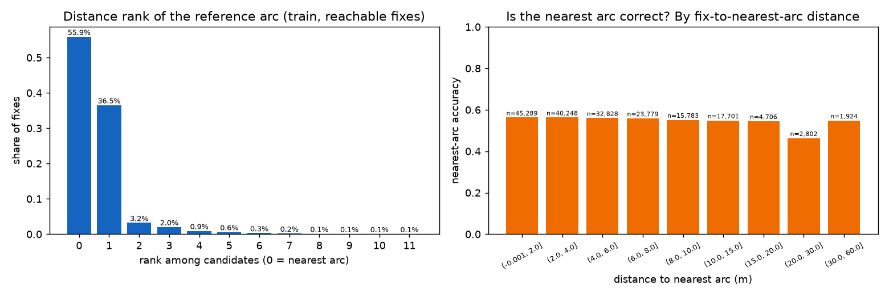

*Figure: nearest-arc baseline (`results/eda/nearest_arc_baseline.png`).* Left: for fixes whose reference arc is a candidate, the share where the reference arc is the 1st, 2nd, ... nearest. The nearest arc is right only 55.9 % of the time, the second nearest 36.5 %, and everything else together 7.6 %. Right: the nearest arc's accuracy stays at about 55 to 56 % whether the fix is 1 m or 15 m from the road. Takeaway: distance is not what decides, direction is. Among the cases where the reference arc is the second nearest, 89.3 % are exact distance ties with the nearest arc, and for 65.1 % of fixes the two nearest arcs are tied: they are the two directions of the same road with identical geometry. Choosing the nearest is a coin flip between directions. This is why we engineer direction features (heading versus arc bearing) and why a classifier is needed at all.

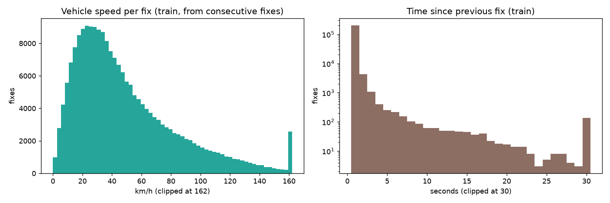

*Figure: speed and time gaps (`results/eda/speed_and_gaps.png`).* Left: speed implied by consecutive fixes; the median is 39.9 km/h and the 95th percentile 119.9 km/h (the spike at the right edge is the clipping at 162 km/h, 99th percentile 167 km/h), so the data mixes city and motorway driving. Right (log scale): time since the previous fix; nearly everything is 1 s, with a long thin tail of gaps. Takeaway: kinematic features (speed, heading) are meaningful but must be switched off across gaps.

### 3.6 Key takeaways for the presentation

* There are 90 development trips and 227,577 GPS fixes. Each trip has its own road network (up to 307,392 arcs), so we work trip by trip.
* The trips come from all over the world, so each trip gets its own local metre projection.
* There are no missing values or time reversals, but gaps are common (45 of 80 training trips) and road networks are fragmented.
* The reference route is a list of arcs, not a per-point label, so we align fixes to it ourselves.
* Two training trips (54 and 33) mostly disagree with their reference route; they cause 92.6 % of all candidate misses. We do not train on unlabelled fixes but we count them as errors when evaluating.
* The nearest road is correct only 55.9 % of the time because each road exists as two directed arcs at identical distance. Direction features are essential.
* Student-test trips are cleaner than training trips (miss rate 0.20 % against 10.9 %), so test scores are higher than cross-validation scores. That is a property of the data, not of better models.

---

## 4. Candidates, labels and features

**Candidates.** For each GPS fix we take the nearest directed arcs within 60 m, at most 12 (if none lies within 60 m we keep the single nearest one). That gives 1,484,604 candidate rows for the 208,417 training fixes (160,114 rows for the 19,160 student-test fixes).

**Labels.** A candidate row is positive (1) when its arc equals the aligned reference arc for that fix, otherwise negative (0). Training uses 1,427,167 of the 1,484,604 training rows, because fixes without a positive candidate are dropped.

**Features** (the 28 in `FEATURES`, `src/pathsnap/candidates.py`):

| Feature | Meaning |
|---|---|
| `d` | distance from the fix to the arc (m) |
| `d_rank` | rank of this arc by distance among the fix's candidates (0 = nearest) |
| `d_rel` | `d` minus the nearest candidate's distance |
| `d_ratio` | `d` divided by (nearest distance + 1) |
| `frac` | position of the projection along the arc (0 = start, 1 = end) |
| `arc_len` | arc length (m) |
| `d_to_start`, `d_to_end` | metres from the projection to the arc's start / end |
| `cos_h` | cosine between the GPS movement direction and the arc direction (+1 = same way) |
| `abs_ang` | the same, as an angle in degrees |
| `cos_h_prev`, `cos_h_next` | the direction agreement using only the previous / next step |
| `speed` | speed from consecutive fixes (m/s); missing across gaps |
| `step_prev`, `step_next` | distance to the previous / next fix |
| `dt_prev`, `dt_next` | time to the previous / next fix |
| `deg_from`, `deg_to` | number of arcs touching the arc's start / end node |
| `outdeg_to` | number of arcs leaving the end node |
| `has_reverse` | 1 if the opposite-direction arc exists (two-way road) |
| `n_cands` | number of candidates for this fix |
| `n_dir_ok` | how many of the fix's candidates point the same way as the movement (`cos_h` above 0.5) |
| `d_prev`, `d_next` | distance of the previous / next fix to this same arc (do neighbours also fit it?) |
| `dprog_ok` | progress along the arc from this fix to the next, divided by the actual step |
| `min_d_dir_ok` | smallest distance among direction-consistent candidates |
| `d_vs_best_dir` | `d` minus `min_d_dir_ok` |

Why these features: distance and rank describe proximity; the direction family (`cos_h`, `abs_ang`, `n_dir_ok`, `d_vs_best_dir`) resolves the two-directions tie we saw in section 3.5; `d_prev`, `d_next` and `dprog_ok` add context from neighbouring fixes without leaving the single-fix classifier framework; the network family (`deg_*`, `has_reverse`, `arc_len`) describes junction structure. Speed and gap features tell the model when the heading is unreliable. Missing values (headings across gaps) are median-imputed for the logistic regression and MLP and handled natively by the tree models.

---

## 5. The five models

**Task framing.** Every candidate row is a binary classification problem: "is this arc the reference arc for this fix?" The prediction for a fix is its highest-scored candidate. All five models use the same features and the same splits.

**Validation.** 5-fold `GroupKFold` with trips as groups on the 80 training trips (a trip is never in both the training and validation side of a fold), then a refit on all 80 training trips and evaluation on the 10 student-test trips. Seeds are fixed (42).

**Metrics.**

* *Macro-F1* is the F1 score averaged over the two classes (reference arc / not reference), with the decision rule "the top-scored candidate per fix is predicted positive". It is computed on fixes whose reference arc is a candidate. It is our **primary selection metric** (CV macro-F1), because it is group-aware, uses all candidates and is not dominated by the many easy negatives.
* *Top-1 accuracy* is the share of fixes where the top-scored candidate is the reference arc. `all` counts fixes without a candidate hit as wrong; `reachable` ignores them.
* *Log loss* measures probability quality, which matters because the HMM uses the probabilities.
* *Route continuity* is the share of consecutive fixes whose predicted arcs are the same or head-to-tail adjacent.
* *Precision and recall* of the positive class are identical (equal to top-1 accuracy on reachable fixes) because exactly one candidate per fix is selected, so every false positive pairs with a false negative (see the confusion matrices).

### Results at a glance

| Model | CV macro-F1 (mean ± std) | CV top-1 (reachable) | CV log loss | Test macro-F1 | Test top-1 (all) | Test log loss | Test continuity | Final-fit time | Inference (ms / 1000 fixes) |
|---|---|---|---|---|---|---|---|---|---|
| Logistic Regression | 0.9020 ± 0.0200 | 0.8295 | 0.1280 | 0.9103 | 0.8404 | 0.1091 | 0.9256 | 22 s | 12.0 |
| Random Forest | 0.9138 ± 0.0199 | 0.8501 | 0.0943 | 0.9200 | 0.8575 | 0.0793 | 0.9315 | 360 s | 88.4 |
| LightGBM | 0.9128 ± 0.0203 | 0.8483 | 0.1002 | 0.9189 | 0.8554 | 0.0838 | 0.9302 | 60 s | 114.1 |
| **XGBoost** | **0.9153 ± 0.0199** | **0.8527** | **0.0943** | **0.9228** | **0.8623** | **0.0774** | 0.9399 | 53 s | 27.9 |
| MLP (64-32) | 0.9125 ± 0.0189 | 0.8479 | 0.1017 | 0.9193 | 0.8562 | 0.0827 | **0.9403** | 598 s | 12.7 |

Source: `results/models/comparison.csv` (all five rows) and `results/models/cv_folds.csv`. "Final-fit time" is the time to fit on all 80 training trips; the cross-validation cost is in `total_cv_time_s`. The student-test candidate miss rate is 0.20 % for every model (the candidate set is shared).

**Timing caveat.** The five models were run at the same time on one machine, each with a different thread budget (Logistic Regression 2, Random Forest 6, LightGBM 4, XGBoost 4, MLP 2) and under heavy shared load. Training and inference times are therefore only indicative of the order of magnitude, not a controlled benchmark.

### 5.1 Logistic Regression (linear / probabilistic)

* **Why we tried it.** It is the natural baseline: fast, gives calibrated probabilities, and tells us how much a linear combination of the features can already do.
* **Strengths.** Very fast (22 s final fit, 12.0 ms per 1000 fixes), stable, easy to explain.
* **Limitations.** The decision depends on interactions (close *and* pointing the right way; a neighbour that also fits) that a linear boundary cannot form.
* **Configuration.** Median imputation with missing-indicators, standardisation, L2 regularisation, `C = 1.0`, lbfgs solver, up to 300 iterations. Objective: log loss.
* **Results.** CV macro-F1 0.9020 ± 0.0200; test top-1 0.8404, macro-F1 0.9103, log loss 0.1091.
* **Fit assessment.** It is the weakest model on every metric (CV log loss 0.1280 against 0.0943 for the best), and the gap to the non-linear models is roughly constant in every fold (see the fold plot below). That points to **mild underfitting**: the model lacks the capacity for the interactions. There is no sign of overfitting: CV and test scores are close.

### 5.2 Random Forest (bagging ensemble)

* **Why we tried it.** Trees capture the interactions between distance, direction and neighbour features without scaling, and tolerate missing values; bagging gives stable, smooth probabilities.
* **Strengths.** Strong accuracy and the second-best log loss (CV 0.0943, test 0.0793), robust to the odd features.
* **Limitations.** Slow to train (360 s final fit, 1,478 s for the whole cross-validation) and slower to predict than XGBoost (88.4 against 27.9 ms per 1000 fixes); large model files.
* **Configuration.** 150 trees, maximum depth 14, minimum 10 samples per leaf, each tree sees a 40 % bootstrap sample. Objective: Gini impurity splits.
* **Results.** CV macro-F1 0.9138 ± 0.0199; test top-1 0.8575, macro-F1 0.9200, log loss 0.0793.
* **Fit assessment.** CV and test results agree and the depth and leaf size limits keep the trees from memorising. We did not record training-set scores for the non-neural models, so we cannot quantify a train-validation gap; we judge fit from the agreement of CV and student-test scores.

### 5.3 LightGBM (gradient boosting)

* **Why we tried it.** Boosting corrects the errors of earlier trees and is the standard strong learner on tabular data of this size.
* **Strengths.** Fast to train (60 s) and accurate (CV macro-F1 0.9128).
* **Limitations.** Slightly worse than XGBoost on every comparison metric, and the slowest to predict in our runs (114.1 ms per 1000 fixes).
* **Configuration.** 300 trees, learning rate 0.05, 31 leaves, minimum 20 samples per leaf, row and column subsampling 0.8. Objective: binary log loss.
* **Results.** CV macro-F1 0.9128 ± 0.0203; test top-1 0.8554, macro-F1 0.9189, log loss 0.0838.
* **Fit assessment.** CV and test agree; it is slightly behind XGBoost in the log loss (CV 0.1002 against 0.0943), which hints at a little less sharp probabilities, not at overfitting.

### 5.4 XGBoost (gradient boosting) - selected model

* **Why we tried it.** Same family as LightGBM, with a different tree-growth strategy (depth-limited trees).
* **Strengths.** Best CV macro-F1, best test top-1, macro-F1 and log loss, high route continuity (0.9399) and fast inference (27.9 ms per 1000 fixes). Probabilities are good, which is what the HMM needs.
* **Limitations.** Many hyperparameters to tune; the differences to Random Forest and LightGBM are small (see section 6).
* **Configuration.** 300 trees, learning rate 0.1, maximum depth 6, row and column subsampling 0.8, histogram tree method. Objective: logistic loss.
* **Results.** CV macro-F1 0.9153 ± 0.0199; test top-1 0.8623, macro-F1 0.9228, log loss 0.0774.
* **Fit assessment.** CV and test scores agree and are the best of the five; no evidence of overfitting or underfitting beyond what the data's difficulty explains.

### 5.5 MLP, 64-32 (neural network)

* **Why we tried it.** A different family: it learns feature combinations by itself and is the only model with an epoch-wise training history.
* **Strengths.** Quick predictions (12.7 ms per 1000 fixes) and the highest test route continuity (0.9403).
* **Limitations.** Slowest to train (598 s), needs imputation and scaling, and is no better than the boosted trees on this table-shaped problem.
* **Configuration.** Two hidden layers (64 and 32 units), ReLU, Adam, learning rate 1e-3, batch size 2,048, L2 penalty 1e-4, up to 25 epochs with early stopping on a held-out set of trips (patience 4), the best epoch's weights restored. Objective: log loss.
* **Results.** CV macro-F1 0.9125 ± 0.0189; test top-1 0.8562, macro-F1 0.9193, log loss 0.0827.
* **Fit assessment.** The loss curves below are from the final fit on all training trips.

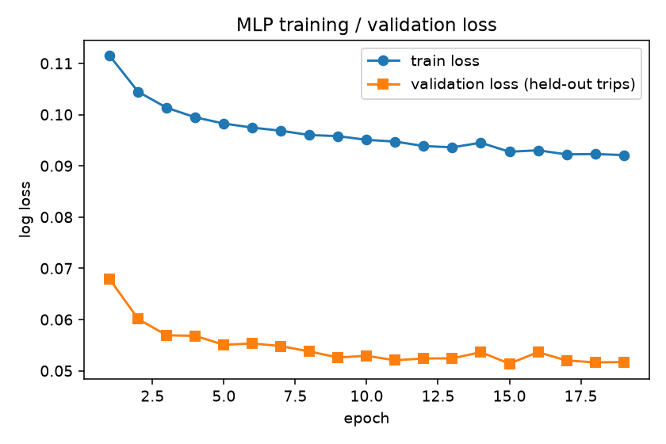

*Figure: MLP training and validation loss (`results/figures/mlp_loss_curve.png`).* Both losses fall steadily over 19 epochs (training 0.1115 to 0.0921, validation 0.0679 to 0.0517) and flatten; early stopping ended training at epoch 19 and the weights from epoch 15 (lowest validation loss, 0.0514) were kept. The validation loss is **lower than** the training loss. That does not mean the model generalises better than it fits: the validation set is a random 10 % of training trips, and those trips happened to be easier than the rest (trip difficulty varies a lot, see section 3). The useful reading is that the gap does not grow and validation loss does not turn upward, so there is no sign of overfitting, and the curve flattening shows the network has largely converged (a mild underfit relative to the trees is possible but unproven). This curve is the only training history in the report; the other models do not produce epoch-wise histories, and we do not fabricate any.

---

## 6. Model comparison and selection

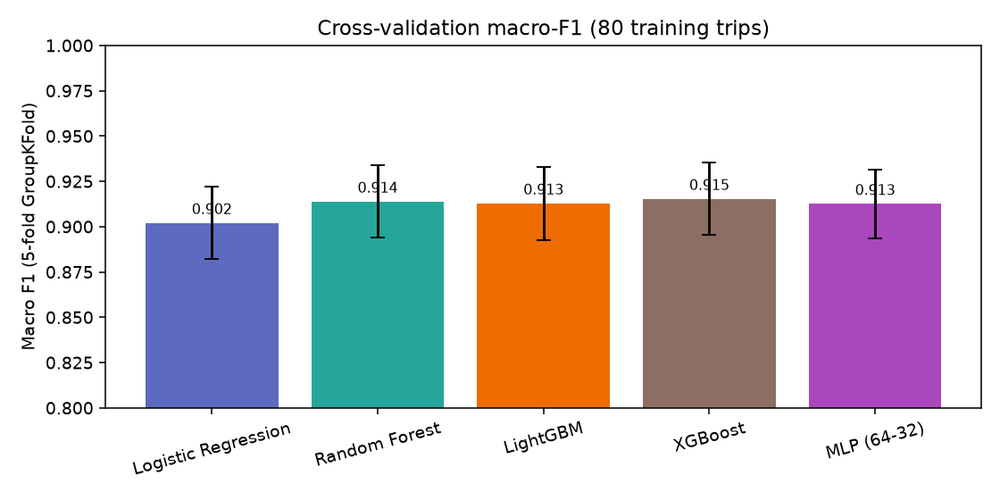

*Figure: cross-validation macro-F1 (`results/figures/cv_macro_f1.png`).* Bars are the mean macro-F1 over the 5 group folds, with the standard deviation as error bars. Logistic Regression is clearly lowest (0.9020); the other four are within about 0.003 of each other (0.9125 to 0.9153). Takeaway: non-linear models are needed, but the error bars (about 0.02) are larger than the gaps between the four best, so the mean alone cannot separate them.

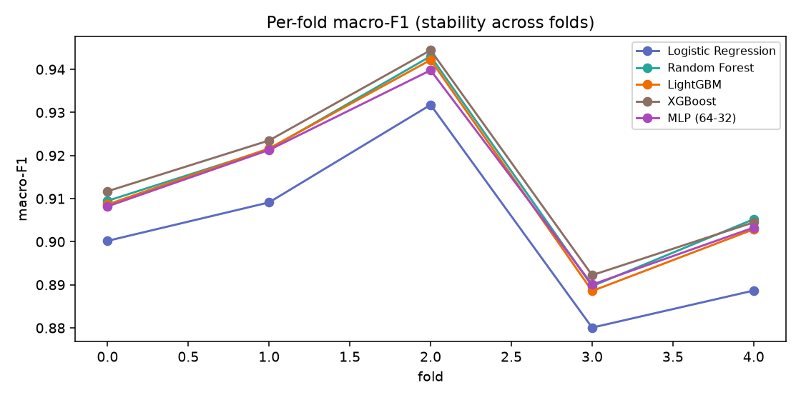

*Figure: per-fold macro-F1 (`results/figures/cv_fold_stability.png`).* One line per model, one point per fold. All models rise and fall together (fold 2 is the easiest at about 0.94, fold 3 the hardest at about 0.89): the 0.02 spread is **trip difficulty**, not model noise. Because the lines barely cross, a paired comparison is meaningful.

**Paired fold differences** (computed from `results/models/cv_folds.csv`, XGBoost minus the other model, macro-F1, folds 0 to 4):

| XGBoost beats | Folds won | Differences per fold |
|---|---|---|
| LightGBM | 5 of 5 | +0.0031, +0.0019, +0.0023, +0.0037, +0.0016 |
| MLP | 5 of 5 | +0.0035, +0.0022, +0.0047, +0.0022, +0.0012 |
| Random Forest | 4 of 5 | +0.0022, +0.0020, +0.0014, +0.0025, -0.0007 |
| Logistic Regression | 5 of 5 | +0.0115, +0.0144, +0.0127, +0.0122, +0.0158 |

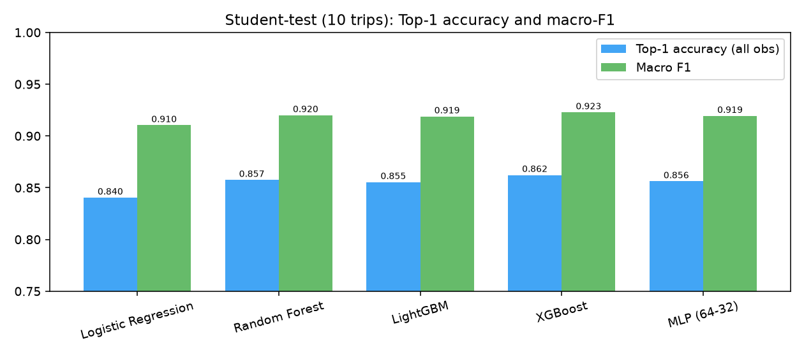

*Figure: student-test top-1 accuracy and macro-F1 (`results/figures/test_top1_macro_f1.png`).* For each model the blue bar is top-1 accuracy over all fixes and the green bar is macro-F1, on the 10 held-out student-test trips. XGBoost is highest on both (0.8623 and 0.9228); the others range from 0.8404 to 0.8575 top-1. Test scores are above CV scores because the student-test trips have far fewer unmatched fixes (0.20 % against 10.9 %).

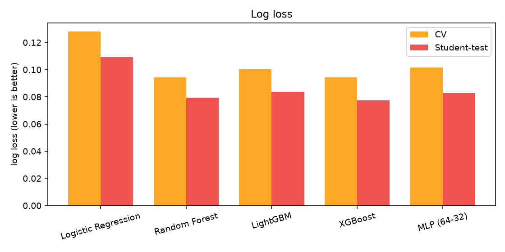

*Figure: log loss (`results/figures/log_loss.png`).* Lower is better; orange is cross-validation, red is student-test. XGBoost has the lowest test log loss (0.0774), Random Forest the next (0.0793), and Logistic Regression is clearly worst (CV 0.1280). Good probabilities matter because the HMM turns them into path scores.

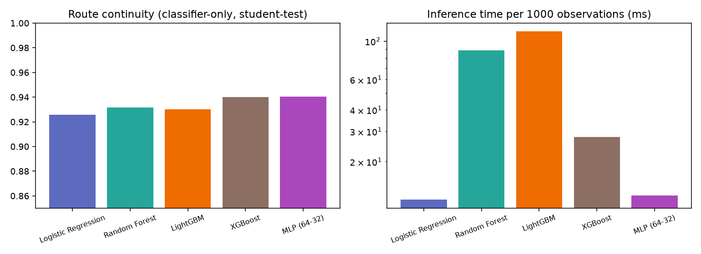

*Figure: route continuity and inference time (`results/figures/continuity_inference_time.png`).* Left: continuity of the classifier-only route on student-test (the y axis starts at 0.85); XGBoost and the MLP are highest (0.9399 and 0.9403) and Logistic Regression lowest (0.9256). Right (log scale): inference time per 1,000 fixes; Logistic Regression and the MLP are fastest (about 12 ms), XGBoost 27.9 ms, Random Forest 88.4 ms, LightGBM 114.1 ms.

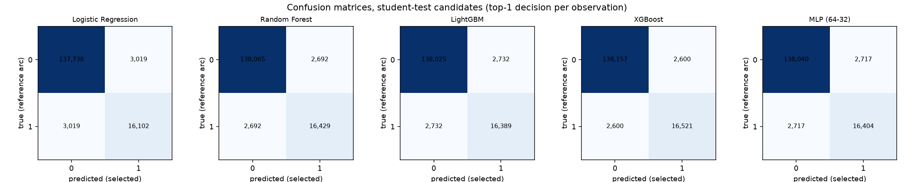

*Figure: confusion matrices on student-test (`results/figures/confusion_matrices.png`).* Each matrix counts candidate rows (rows = true label, columns = selected or not) using "pick the top candidate per fix". The bottom-right cell is the number of fixes solved correctly, the off-diagonal cells are fixes where a wrong arc was chosen over the right one (the two off-diagonal numbers are equal by construction). XGBoost makes 2,600 such mistakes out of 19,121 fixes (16,521 correct); Logistic Regression makes 3,019. Optional diagnostic: the counts are dominated by easy negatives, which is why we select on macro-F1 and top-1 rather than raw accuracy.

**Selection argument.**

* The **primary metric** is group-CV macro-F1: it uses only training trips, respects the trip structure and is not influenced by the student-test partition.
* **XGBoost has the highest mean CV macro-F1** (0.9153), the highest test top-1 (0.8623), macro-F1 (0.9228) and the lowest test log loss (0.0774).
* The paired differences show it ahead of LightGBM and the MLP in every fold and of Random Forest in 4 of 5, so the lead is consistent although small.
* It trained in 53 s (Random Forest 360 s, MLP 598 s) and predicted in 27.9 ms per 1000 fixes, which suits an API that answers an evaluator request. These times come from parallel runs with different thread budgets (see the timing caveat above), so we use them as a rough guide only; the accuracy and log-loss arguments carry the decision.
* It produces good probabilities (low log loss), which the HMM needs, and its continuity (0.9399) is among the best.
* We were careful that the student-test partition did not choose the model: the CV ranking already puts XGBoost first.

We select **XGBoost** for hyperparameter optimisation and for the HMM.

<!-- SECTION:BAYESIAN_OPTIMISATION -->
## 7. Bayesian hyperparameter optimisation

We tuned **XGBoost**, the model selected in section 6, with Optuna's TPE sampler (a Bayesian method: it fits a model of which parameter regions gave good scores and proposes new trials there). Code: `scripts/03_bayes_opt.py`. The full search record is committed: `results/bayes/xgboost/study.db` (the Optuna study), `trials.csv`, `best_params.json`, `tuned_vs_untuned.csv`.

**What was searched, and the ranges**

| Hyperparameter | Distribution | Range | Untuned value |
|---|---|---|---|
| `n_estimators` (number of trees) | integer, step 50 | 100 to 600 | 300 |
| `learning_rate` | log-uniform | 0.01 to 0.3 | 0.1 |
| `max_depth` | integer | 3 to 12 | 6 |

Only these three were searched; `subsample` and `colsample_bytree` stayed at 0.8. We kept the space small because every trial costs five full model fits.

**Objective.** Maximise the mean macro-F1 of 5-fold `GroupKFold` (groups = trips) on the 80 training trips, using the same "pick the top candidate per observation" decision rule as everywhere else. The student-test partition was **not** used by the search. It was used only afterwards to compare tuned and untuned models. The evaluator partition was never touched.

**Trials.** 22 trials completed (the first 8 were random start-up trials, the rest chosen by TPE). 2 more were cut off when we restarted the run to use more CPU cores; they are marked failed in the study and do not count. We planned 20 trials; the run was resumed with three trials in parallel and stopped once 20 had completed, but trials that were already running finished too, so the record contains 22. The search ran from a persistent SQLite study, so the trials of the two sessions are in one record. Wall-clock time of the final session: 36 minutes; single trials took 1.2 to 14.2 minutes depending on the number of trees and the CPU load at that moment.

**Best configuration.** `n_estimators = 350`, `learning_rate = 0.0203`, `max_depth = 10`, CV macro-F1 = 0.91594.

The five best trials:

| Trial | n_estimators | learning_rate | max_depth | CV macro-F1 | Minutes |
|---|---|---|---|---|---|
| 1 | 350 | 0.0203 | 10 | 0.91594 | 6.0 |
| 22 | 400 | 0.0170 | 9 | 0.91582 | 7.4 |
| 15 | 600 | 0.0183 | 8 | 0.91570 | 10.9 |
| 19 | 450 | 0.0109 | 12 | 0.91567 | 14.2 |
| 0 | 550 | 0.0315 | 9 | 0.91553 | 8.5 |

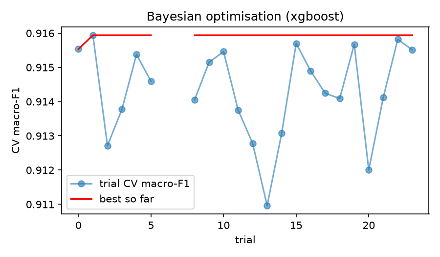

*Each dot is one trial's CV macro-F1, the line is the best score so far. The curve is nearly flat: all 22 trials scored between 0.9110 and 0.9159 (mean 0.9143). The best trial was found early, during the random start-up phase, and TPE did not improve on it. Read this as "XGBoost is not very sensitive to these three parameters on this problem", not as "the search failed".*

**Tuned against untuned** (same folds, same metrics, same partitions; the untuned model uses the configuration from section 5.4)

*The untuned CV macro-F1 here (0.9150) differs in the third decimal from section 6 (0.9153) because this comparison refits both variants in one script with different thread counts; tree-library results depend slightly on thread scheduling. Both variants in this table were fitted the same way.*

| | CV macro-F1 | CV top-1 (reachable) | CV log loss | Student-test top-1 | Student-test macro-F1 | Student-test log loss | Student-test continuity | Inference per 1000 obs | Fit time |
|---|---|---|---|---|---|---|---|---|---|
| Untuned | 0.9150 | 0.8529 | 0.0941 | 0.8596 | 0.9213 | 0.0777 | 0.9388 | 29 ms | 54 s |
| **Tuned** | **0.9159** | **0.8547** | **0.0919** | **0.8601** | **0.9216** | **0.0769** | **0.9408** | 159 ms | 110 s |

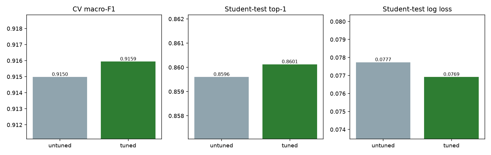

**Did tuning help? Yes, but only slightly.**
* The tuned model is ahead on every quality metric, but the gains are small: CV macro-F1 0.0010, student-test top-1 0.0005, student-test log loss 0.0008 lower.
* The CV gain is far smaller than the fold-to-fold spread (standard deviation about 0.017). Paired by fold, the tuned model scores higher in 3 of 5 folds (differences: +0.0015, -0.0001, -0.0009, +0.0009, +0.0034).
* The price is speed: the tuned model has more and deeper trees, so one prediction pass over 1000 observations takes about 159 ms instead of 29 ms and fitting takes 110 s instead of 54 s. In the API this is still small compared with the HMM step (section 9).
* We use the tuned model as the final model (`models/final/model.joblib`) because it is at least as good on every metric and the cost is acceptable. We do not claim the improvement is statistically meaningful.

<!-- SECTION:HMM_VITERBI -->
## 8. HMM and Viterbi route reconstruction

Code: `src/pathsnap/hmm.py` (decoder), `src/pathsnap/decode_eval.py` (metrics), `scripts/04_tune_decoder.py` (tuning and comparison). The decoder uses the **tuned XGBoost scores** of section 7, so classifier and HMM are consistent.

**Why we need it.** The classifier scores every observation on its own, so consecutive observations can be assigned to arcs that are not connected in the road network, which gives a jumpy, impossible route. The HMM forces the whole sequence to be physically possible.

**1. What are the hidden states?** For each GPS observation, the hidden state is *which candidate arc the vehicle is on*. The states of observation *t* are exactly the candidate arcs of that observation (at most 12), and each state keeps its arc id, so the decoded path maps straight back to road segments.

**2. How are emission probabilities calculated?** From the classifier. For observation *t* we take the XGBoost probabilities of its candidates, clip them at 1e-4 and normalise them to sum to 1 across the candidates. The emission score is the log of that value times `w_emit` (1.0) minus a small Gaussian distance term, `w_dist * d^2 / (2 * sigma^2)`, where `d` is the metres between the GPS point and the arc.

**3. How are transition probabilities calculated?** In the style of Newson and Krumm. For two consecutive observations and a pair of candidate arcs, we compare the straight-line distance between the two GPS points with the distance a vehicle would have to drive along the road network between the projected positions on the two arcs (a bounded Dijkstra search on the arc graph, limited to the smaller of `3 x straight-line + 150 m` and 3 km). The score is `-w_trans * |straight-line - network distance| / beta`. If the two arcs are the same, the distance is simply how far the projection moved along the arc.

**4. How are missing candidates and large GPS gaps handled?**
* Every observation has at least one candidate by construction: if no arc lies within 60 m, the single nearest arc is kept, so the decoder never faces an empty state set.
* If the time between two observations is larger than `gap_s` (tuned to 33.8 s), the transition is made uninformative (all zero), so the path can restart at the best-scoring candidates instead of being forced through a distance comparison that no longer means anything. Network distances are not computed at all for gaps above 60 s.

**5. What happens when consecutive observations suggest disconnected road segments?** If a candidate pair is not reachable within the search limit, it gets a finite penalty `break_pen` (tuned to 19.4) instead of probability zero. That makes such jumps very unlikely but not impossible, so the decoder can still jump when the evidence is overwhelming (for example after a GPS dropout), and it never crashes on a fragmented network. Reversing onto the opposite arc of the same road costs an additional `uturn_pen` (8.0).

**Viterbi recurrence.** `delta_t(j) = emission_t(j) + max_i [ delta_{t-1}(i) + transition(i, j) ]`, with back-pointers; the final path is read backwards from the best last state. All scores are in log space.

**Decoder parameters.** Tuned with Optuna TPE (40 trials, seed 7) to maximise pointwise accuracy on the **out-of-fold** classifier scores of 29 sampled training trips (trips 54 and 33 left out of the objective because their reference routes do not match the GPS, see `docs/data_quality.md`). Using out-of-fold scores means the classifier had not seen those trips, as at test time. Student-test data was used only for reporting.

| Parameter | Tuned value | Meaning |
|---|---|---|
| `w_emit` | 1.0 | weight of the classifier log-probability (fixed) |
| `w_dist` | 0.098 | weight of the Gaussian distance term |
| `sigma` | 24.6 m | width of the distance term |
| `beta` | 7.9 m | tolerance for straight-line vs network distance mismatch |
| `w_trans` | 1.31 | weight of the transition term |
| `break_pen` | 19.4 | log-penalty for unreachable arc pairs |
| `uturn_pen` | 8.0 | extra log-penalty for an immediate U-turn |
| `gap_s` | 33.8 s | time gap above which the transition is ignored |

**6. Did HMM decoding improve the final route?** Yes, clearly. Pointwise accuracy is the share of observations whose predicted arc equals the aligned reference arc. Continuity is the share of consecutive observations whose arcs are the same or head-to-tail adjacent. Route F1 compares the set of predicted arcs with the set of reference route arcs. "Switches" counts how often the predicted arc changes along a trip; the reference route switches 310 times per trip on average on the student-test trips, so a number close to that is realistic.

*Student-test partition (10 trips)*

| Method | Point accuracy | Mean per-trip accuracy | Continuity | Route F1 | Route precision | Route recall | Avg arc switches (reference: 310) |
|---|---|---|---|---|---|---|---|
| Classifier only | 0.8601 | 0.8777 | 0.9394 | 0.8612 | 0.8414 | 0.8884 | 538 |
| Classifier + HMM (default parameters) | 0.8955 | 0.9069 | 0.9734 | 0.9116 | 0.9358 | 0.8917 | 339 |
| **Classifier + HMM (tuned)** | **0.9307** | 0.9396 | 0.9775 | 0.9330 | 0.9678 | 0.9033 | 321 |

*Training partition, out-of-fold scores (80 trips)*

| Method | Point accuracy | Mean per-trip accuracy | Continuity | Route F1 | Route precision | Route recall | Avg arc switches (reference: 353) |
|---|---|---|---|---|---|---|---|
| Classifier only | 0.7615 | 0.8512 | 0.9265 | 0.8401 | 0.8148 | 0.8844 | 744 |
| Classifier + HMM (default parameters) | 0.8166 | 0.9024 | 0.9663 | 0.9061 | 0.9281 | 0.8909 | 417 |
| **Classifier + HMM (tuned)** | **0.8329** | 0.9160 | 0.9699 | 0.9212 | 0.9518 | 0.8967 | 401 |

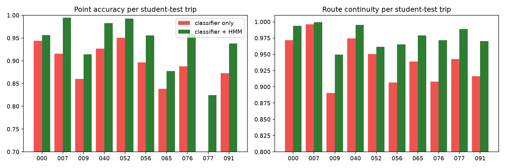

*Left: pointwise accuracy of each student-test trip, classifier only (red) against classifier + HMM (green). Right: route continuity. Green is higher for every trip.*

**Per student-test trip**

| Trip | Obs | Acc: classifier | Acc: + HMM | Change (points) | Continuity: classifier | Continuity: + HMM | Route F1: classifier | Route F1: + HMM |
|---|---|---|---|---|---|---|---|---|
| 00000000 | 2503 | 0.9441 | 0.9565 | +1.2 | 0.9716 | 0.9940 | 0.8740 | 0.9425 |
| 00000007 | 1354 | 0.9158 | 0.9948 | +7.9 | 0.9963 | 0.9993 | 0.9680 | 0.9878 |
| 00000009 | 1049 | 0.8599 | 0.9142 | +5.4 | 0.8903 | 0.9494 | 0.8412 | 0.8969 |
| 00000040 | 2995 | 0.9269 | 0.9830 | +5.6 | 0.9743 | 0.9950 | 0.8997 | 0.9770 |
| 00000052 | 262 | 0.9504 | 0.9924 | +4.2 | 0.9502 | 0.9617 | 0.8571 | 0.9266 |
| 00000056 | 3958 | 0.8964 | 0.9560 | +6.0 | 0.9065 | 0.9654 | 0.9006 | 0.9386 |
| 00000065 | 768 | 0.8385 | 0.8776 | +3.9 | 0.9387 | 0.9791 | 0.8400 | 0.9437 |
| 00000076 | 1486 | 0.8876 | 0.9590 | +7.1 | 0.9077 | 0.9717 | 0.8035 | 0.9083 |
| 00000077 | 3911 | 0.6842 | 0.8249 | +14.1 | 0.9425 | 0.9887 | 0.8094 | 0.9483 |
| 00000091 | 874 | 0.8730 | 0.9382 | +6.5 | 0.9164 | 0.9702 | 0.8180 | 0.8599 |

**What the numbers say**
* The decoder raises student-test point accuracy from 0.8601 to 0.9307 and continuity from 0.9394 to 0.9775. Route precision rises most (0.8414 to 0.9678) because the classifier alone sprinkles in many wrong arcs that the HMM removes.
* The number of arc switches falls from 538 to 321 per trip, close to the reference's 310: the classifier-only route flickers between neighbouring arcs, the HMM route does not.
* Even the default decoder parameters help a lot (student-test accuracy 0.8955); tuning adds a further 3.5 points. The tuned parameters were chosen on training data only and the gain is at least as large on the untouched student-test trips (3.5 points) as on the training trips (1.6 points), so we see no sign of the decoder overfitting its tuning set.

**Where HMM decoding helped little or not at all**
* On the student-test trips accuracy improved for all 10 trips, but unevenly. The largest gain is trip 00000077 (+14.1 points); the smallest is trip 00000000 (+1.2 points), where the classifier was already at 0.9441.
* Trip 00000009 still has the lowest HMM continuity (0.9494).
* On the 80 training trips (out-of-fold scores) the HMM made pointwise accuracy *worse* on 2 trips: trip 00000057 (-3.4 points, 1645 observations); trip 00000063 (-0.5 points, 2781 observations). Accuracy improved on 77 of the 80 training trips (median gain +5.6 points). In both trips where it fell, continuity still rose (trip 00000057: 0.9647 to 0.9866, trip 00000063: 0.9655 to 0.9802): the route became more connected but some points moved to a different arc than the reference. We have not examined those two trips in detail.
* Trip 00000077 shows the limit of the approach: the HMM lifts accuracy by 14.1 points but it remains the weakest trip at 0.8249. An error breakdown of the classifier-only predictions (`scripts/11_error_analysis.py`, untuned XGBoost scores) shows why: of its 1,198 wrong observations, 892 are `reverse_direction` (the opposite arc of the same two-way road, which has identical geometry), 260 are neighbouring arcs and 46 are other. The HMM reduces this but cannot remove it, because the two directions look the same to both the classifier and the distance-based transition term. This breakdown has not yet been repeated on the HMM output.

Interactive maps of three student-test trips (GPS points, nearby road arcs, reference route, classifier-only and classifier + HMM routes, with layer control) are in `results/maps/`: `pred_student_00000007.html` (an easy trip), `pred_student_00000009.html` and `pred_student_00000040.html`. They are interactive HTML files, so download and open them in a browser; they are generated by `scripts/08_maps.py`.

<!-- SECTION:API_UI_RESULTS -->
## 9. API, UI and end-to-end results

**Architecture (two laptops, as the rules require).** Laptop 1 runs the FastAPI backend (`api/main.py`): the final model, the decoder, the road-network files and the reference routes. Laptop 2 runs the UI (`ui/`, static HTML and JavaScript with Leaflet). The UI only knows a trip id; everything else happens on Laptop 1.

| Endpoint | What it does |
|---|---|
| `GET /health` | status, model name, number of trips served, data folder |
| `GET /trips` | the trips that can be selected (id and number of GPS points) |
| `POST /predict` with `{"trip_id": "..."}` | runs the full pipeline for that trip and returns the GPS points, the predicted route, the classifier-only route and the metrics |

**Pipeline behind `POST /predict`:** read the raw trip files **without the reference route** (`load_trip(..., with_route=False)` in `src/pathsnap/pipeline.py`), generate candidates and features, score them with the tuned XGBoost model, run Viterbi decoding, and only then call `src/pathsnap/scoring.py`, which loads the reference route on the server, aligns it and computes accuracy, continuity and route F1.

**Ground truth stays on the server.** The prediction code never opens the `.route` file, and the response contains only aggregate metrics, never the reference route. An automated check that no reference field appears in the response is being written as part of `handoffs/HANDOFF_3_Tests_and_Demo_Runbook.md`; until it is merged, this is verified only by reading `api/main.py`. Nothing is hard-coded: the route is computed from the raw files on every request, and each request is logged.

**End-to-end result on all ten student-test trips** (`scripts/07_api_check.py` calling the running API; `results/api_check.csv`). The evaluator trips are not available to us, so this is the stand-in for the demo.

| Trip | Obs | Acc: classifier | Acc: + HMM | Continuity: classifier | Continuity: + HMM | Route F1 (HMM) | Server time (s) |
|---|---|---|---|---|---|---|---|
| 00000000 | 2503 | 0.9441 | 0.9565 | 0.9716 | 0.9940 | 0.9425 | 1.55 |
| 00000007 | 1354 | 0.9158 | 0.9948 | 0.9963 | 0.9993 | 0.9878 | 0.63 |
| 00000009 | 1049 | 0.8599 | 0.9142 | 0.8903 | 0.9494 | 0.8969 | 1.60 |
| 00000040 | 2995 | 0.9269 | 0.9830 | 0.9743 | 0.9950 | 0.9770 | 1.78 |
| 00000052 | 262 | 0.9504 | 0.9924 | 0.9502 | 0.9617 | 0.9266 | 0.27 |
| 00000056 | 3958 | 0.8964 | 0.9560 | 0.9065 | 0.9654 | 0.9386 | 2.22 |
| 00000065 | 768 | 0.8385 | 0.8776 | 0.9387 | 0.9791 | 0.9437 | 0.50 |
| 00000076 | 1486 | 0.8876 | 0.9590 | 0.9077 | 0.9717 | 0.9083 | 1.24 |
| 00000077 | 3911 | 0.6842 | 0.8249 | 0.9425 | 0.9887 | 0.9483 | 2.28 |
| 00000091 | 874 | 0.8730 | 0.9382 | 0.9164 | 0.9702 | 0.8599 | 0.62 |

Server time per request: mean 1.27 s, maximum 2.28 s (a 3,958-observation trip). The observation-weighted accuracy over the ten trips is 0.9307 with the HMM and 0.8601 without. These match section 8, as they must: the API runs the same code.

**What the evaluator sees in the API window on Laptop 1** (a real excerpt from our test run; the client address is the machine that sent the request):

```
2026-11-18 12:13:32,252 INFO GET /trips from 10.30.204.82 -> 10 trips
2026-11-18 12:13:36,740 INFO POST /predict trip_id=00000040 from 10.30.204.82
2026-11-18 12:13:37,852 INFO trip=00000040 obs=2995 hmm_acc=0.9830 clf_acc=0.9269 continuity=0.9950 time=1.11s
INFO:     10.30.204.82:58250 - "POST /predict HTTP/1.1" 200 OK
```

**The UI.** After connecting, it lists the trips. Clicking a trip sends its id to the API and then draws the GPS points, the HMM route (green) and the classifier-only arcs (red, dashed) on a map with a layer control and legend, and shows point accuracy, continuity, route F1, precision and recall for classifier-only against classifier + HMM, plus the server time. The reference route is deliberately not drawn.

**Running it across two devices** is described in section 11. `python scripts/run_api.py` starts the API on all network interfaces and prints the exact addresses Laptop 2 needs.

**What we have and have not verified.** We tested the API and UI together on one machine, including through the machine's network address, and all ten trips worked. A test with a real second laptop (firewall, Wi-Fi) is still to be done and documented with screenshots in `docs/screenshots/`; those screenshots belong in the report's API/UI section.

---

## 10. Viva cheat-sheet

**Problem and data**

1. *What is map-matching?* Turning a noisy GPS trace into the sequence of road segments the vehicle really drove, using the road network.
2. *What are the inputs and outputs?* Inputs: GPS fixes (lon, lat, time) and a road network (nodes and directed arcs). Output: one arc id per fix.
3. *What do the four files contain?* `.track` GPS fixes, `.nodes` junction coordinates, `.arcs` from-to node pairs, `.route` the ordered reference arc ids.
4. *How many trips and fixes?* 80 training trips (208,417 fixes), 10 student-test trips (19,160 fixes), plus 10 evaluator trips we never see.
5. *Why a local projection for each trip?* Trips are spread over several continents (longitude about -100 to 137), so no single projection works, and degrees are not metres. Each trip is converted to metres around its own centre.
6. *What data-quality problems did you find?* No missing values or time reversals; but gaps in 45 of 80 training trips (up to 153,064 s), fragmented road networks (median 20 components), duplicate arcs in 53 of 80 trips, and reference routes that do not match the GPS in two trips.
7. *Is the reference route ground truth?* No. It is an arc list, not a per-point label, and we align fixes to it ourselves. For trips 54 and 33 most fixes are far from it.
8. *What did you do about trips 54 and 33?* Fixes with no reference arc among the candidates are not used for fitting, are counted as errors in `top1_acc_all`, and are left out of the decoder-tuning objective. They account for 92.6 % of the candidate misses. We chose this because of label noise; it is not a standard procedure.

**Candidates and features**

9. *What is a candidate?* A directed arc within 60 m of a fix (at most 12 per fix).
10. *Why not just take the nearest road?* It is right only 55.9 % of the time: each road is two directed arcs with identical geometry, and for 65.1 % of fixes the two nearest arcs tie in distance.
11. *Which features matter and why?* Direction agreement (heading against arc bearing) resolves the tie; distance, rank and neighbour-fit features (`d_prev`, `d_next`) measure how well the arc explains the trace; network features describe junctions.
12. *How are labels made?* Each fix is assigned to a route arc by a monotone dynamic programme over the reference route; a candidate is positive if it is that arc.

**Models and evaluation**

13. *Which five models, and why?* Logistic Regression (linear baseline), Random Forest (bagging), LightGBM and XGBoost (boosting), MLP (neural network): one or two per algorithm family.
14. *How did you validate?* 5-fold `GroupKFold` by trip on the 80 training trips (no trip appears on both sides), then a refit and a student-test evaluation. Never random row splits.
15. *What is the primary metric and why?* Group-CV macro-F1 with the "top candidate per fix" rule: it uses only training trips, respects the trip structure and is balanced across the two classes.
16. *Why do test scores exceed CV scores?* The student-test trips are cleaner: 0.20 % of fixes have no candidate hit, against 10.9 % in training.
17. *Which model won and why?* XGBoost: best CV macro-F1 (0.9153), test top-1 (0.8623), test macro-F1 (0.9228) and test log loss (0.0774); it beats LightGBM and the MLP in 5 of 5 folds and Random Forest in 4 of 5; fast to train (53 s) and to predict.
18. *Is the difference between the top models significant?* The gaps are small (about 0.002 to 0.004 in macro-F1) compared with the fold-to-fold spread (about 0.02), but the folds are paired and XGBoost wins consistently, so the ranking is reliable though the margin is modest.
19. *Did you see overfitting or underfitting?* Logistic Regression underfits (weakest on all metrics, constant gap in every fold). For the trees, CV and test agree, so no overfitting signs, but we did not record training-set scores. The MLP loss curves flatten without a rising validation loss; validation is below training because the held-out trips are easier, not because the model generalises better.
20. *What do precision and recall equal here?* The same number (top-1 accuracy on reachable fixes), because exactly one candidate per fix is selected.
21. *What is route continuity?* The share of consecutive fixes whose predicted arcs are the same arc or head-to-tail adjacent.

**Pipeline and integrity**

22. *What does the HMM add?* Connectivity: a classifier scores each fix on its own, the HMM chooses the sequence whose consecutive arcs are reachable and plausible. Results are in section 8.
23. *How do you keep the evaluator labels away from the model and UI?* The prediction pipeline never loads `.route`; the API scores the prediction against the reference on the server afterwards and returns only metrics, never the reference route.
24. *Where did you not use the evaluator set?* Nowhere: no training, feature selection, hyperparameter choice or threshold choice. We only had `train` and `student_test`.

---

## 11. How to run everything

**Where the data goes.** `train/` (80 trips) and `student_test/` (10 trips) are **not committed**. Place them in the repository root with the layout `<folder>/<trip_id>/<trip_id>.track|nodes|arcs|route`.

**Set up.**

```bash
python -m venv .venv
# Windows:  .venv\Scripts\activate        macOS/Linux:  source .venv/bin/activate
pip install -r requirements.txt
```

**Reproduce the experiments (in this order).**

```bash
python scripts/00_eda_stats.py        # dataset inventory -> results/eda/
python scripts/01_build_dataset.py    # candidates + features + labels -> data/processed/ (git-ignored)
python scripts/05_eda_plots.py        # EDA figures and Folium EDA maps
python scripts/05b_extra_eda.py       # nearest-arc baseline, speed/gap, candidate-miss figures
python scripts/02_compare_models.py   # five models, group CV, student-test (add --models NAME --tag NAME to run one model; run several in parallel)
python scripts/02b_merge_results.py   # only needed if you ran models separately with --tag
python scripts/03_bayes_opt.py --model xgboost --trials 20 --parallel 3 --final   # Bayesian optimisation, writes models/final/ (we used 3 parallel trials, which ended with 22 completed)
python scripts/04_tune_decoder.py --model xgboost --trials 40   # HMM decoder tuning and comparison (updates models/final/decoder.json)
python scripts/06_figures.py          # model comparison figures
python scripts/08_maps.py             # Folium prediction maps for student-test trips
```

`scripts/monitor.py` starts a local dashboard at http://localhost:8765 and `scripts/tui.py` shows the same progress in the terminal.

**Start the API (Laptop 1)** from the repository root:

```bash
# Windows PowerShell:  $env:EVAL_DATA_DIR="student_test"; $env:MODEL_DIR="models/final"
# macOS/Linux:         export EVAL_DATA_DIR=student_test MODEL_DIR=models/final
uvicorn api.main:app --host 0.0.0.0 --port 8000
# or, simpler, this also prints the addresses to use on Laptop 2:
python scripts/run_api.py            # add --data C:/path/to/evaluator_folder to serve other trips
```

* `EVAL_DATA_DIR`: folder with the trips to serve (default `student_test`). For the final evaluation point it at the evaluator trips, in the same file layout; nothing from it is committed.
* `MODEL_DIR`: folder with `model.joblib` and `decoder.json` (default `models/final`).
* Endpoints: `GET /health`, `GET /trips`, `POST /predict` with `{"trip_id": "..."}`.
* `python scripts/07_api_check.py http://localhost:8000` calls every served trip and writes `results/api_check.csv`.

**Start the UI (Laptop 2).**

```bash
python -m http.server 5500 --directory ui
```

Open `http://localhost:5500`, type the API address of Laptop 1 (for example `http://192.168.1.20:8000`) into the API box and press Connect. The ten trips appear; click one to run the pipeline.

**Two-laptop notes.** Both laptops must be on the same network; allow inbound connections to port 8000 in the Laptop 1 firewall; use Laptop 1's LAN address, not `localhost`, in the UI box; the API logs each request, and those logs on Laptop 1 are what you show the evaluator. The UI files are static (Leaflet is bundled in `ui/vendor/`); map tiles need internet access.
